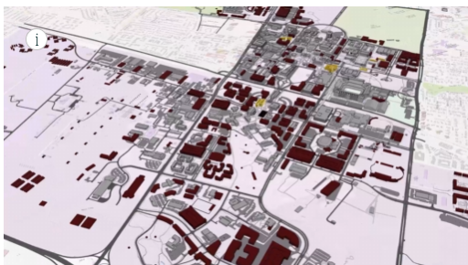
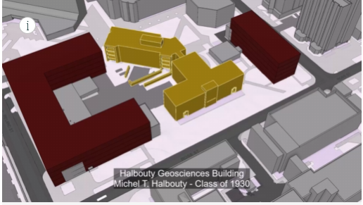
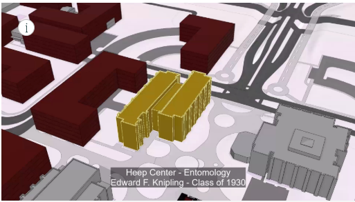
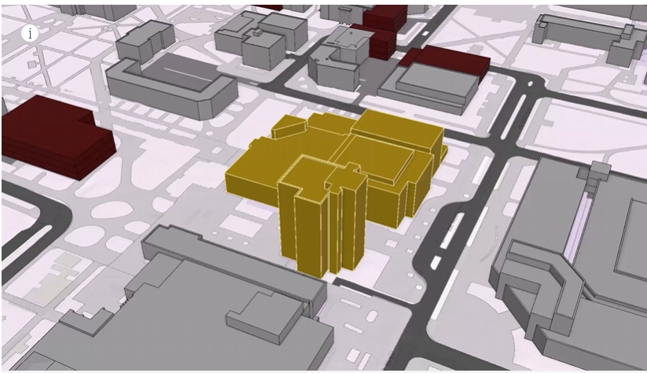
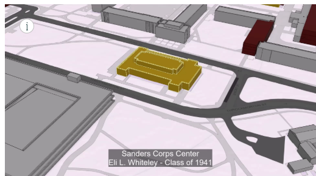
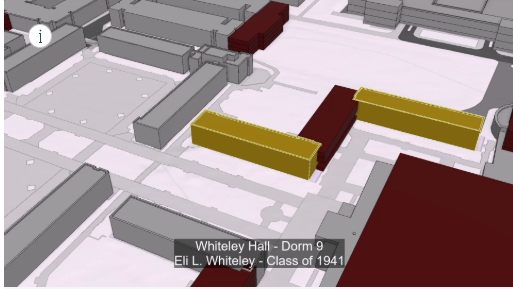

# Week 7 Lab: Aggie Legacies (3D Campus StoryMap)

**StoryMap:** [Aggie Legacies](https://arcg.is/1jr0Hi3)

Texas A&M opened in 1876 and marks its 150th anniversary this year. This StoryMap follows a few of its former students to the campus buildings tied to their fields and legacies, using the TAMU 3D campus layers. Featured buildings are highlighted in gold.

## Screenshots

### Campus overview

### Halbouty Geosciences Building (Michel T. Halbouty '30)

### Heep Center (Edward F. Knipling '30)

### Rudder Tower (James Earl Rudder '32)

### Sanders Corps of Cadets Center

### Whiteley and Harrington Halls

## Data
- TAMU 3D Buildings (2019), Streets, Sidewalks, and Parking Lots (Texas A&M ArcGIS Online)
- Basemap: Esri
- The 2019 building model predates newer campus additions such as Aggie Park (2022). Building colors are shown as provided in the source data.
