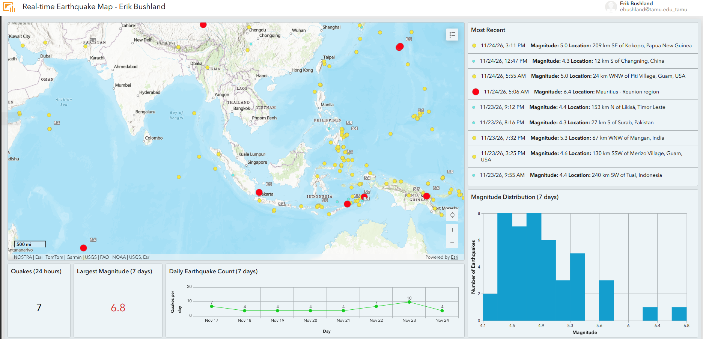
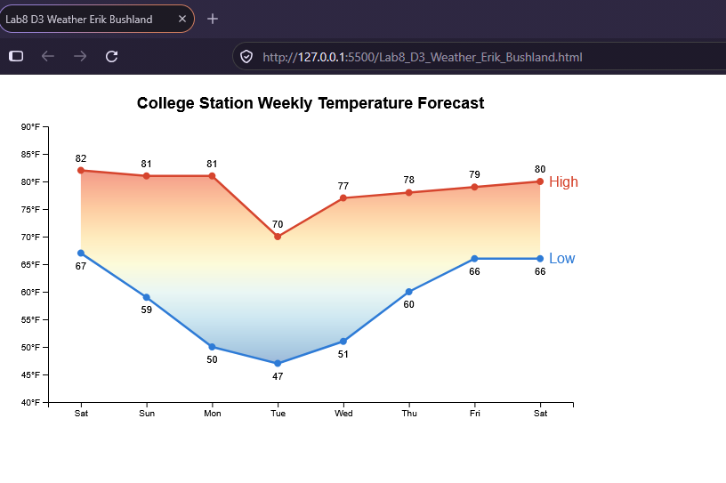
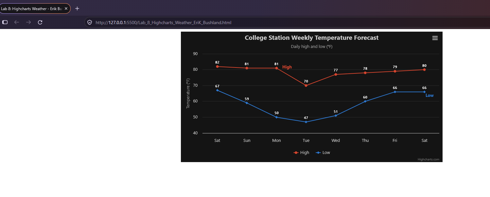

# Week 8 Lab: Interactive Charts (ArcGIS Dashboards, D3, Highcharts)

**Dashboard:** [Real-time Earthquake Map] (https://arcg.is/0uvT892)

This lab covers three ways to build interactive charts: an ArcGIS Dashboard driven by a live data feed, and the same weekly temperature forecast drawn twice, once with D3 and once with Highcharts.

## Real-time Earthquake Dashboard

The original Snowplow tutorial layers are no longer available, so this dashboard uses the Esri Living Atlas Recent Earthquakes live feed instead (approved by the instructor).

- Map, two indicators, a daily count chart, a magnitude histogram, and a most-recent list
- All elements filter to the current map extent
- The Largest Magnitude indicator uses Arcade advanced formatting to turn red at M6.0 and above
- Every element uses a 7-day window (Hours Old <= 168). The feed keeps quakes below M4.5 for only 7 days, so a longer window would overcount larger events.
- Outside the US, the feed mostly reports quakes of M4.5 and up. This is why the histogram for Southeast Asia starts near M4.1.

## College Station Weekly Temperature Forecast

### D3 (v7)

File: `Lab8_D3_Weather_Erik_Bushland.html`

Two-line chart with labeled points. The band between the high and low is filled with a vertical temperature gradient (blue for cool, red for warm). The x-axis is indexed by position so the two Saturdays plot separately.

### Highcharts

File: `Lab8_Highcharts_Weather_Erik_Bushland.html`

Line chart with data labels and a shared tooltip. Colors match the D3 chart.

## Practice Files

- `Lab8_D3_Bars_Erik_Bushland.html`: Task 1, D3 bar chart
- `Lab8_Task2_Erik_Bushland.html`: Task 2, Highcharts solar employment demo
- `Lab8_D3_Weather.png`: D3 weather chart before the gradient band was added

## Data

- Recent Earthquakes (USGS via Esri Living Atlas live feed)
- Temperature forecast values provided in the lab instructions
- Basemap: Esri
